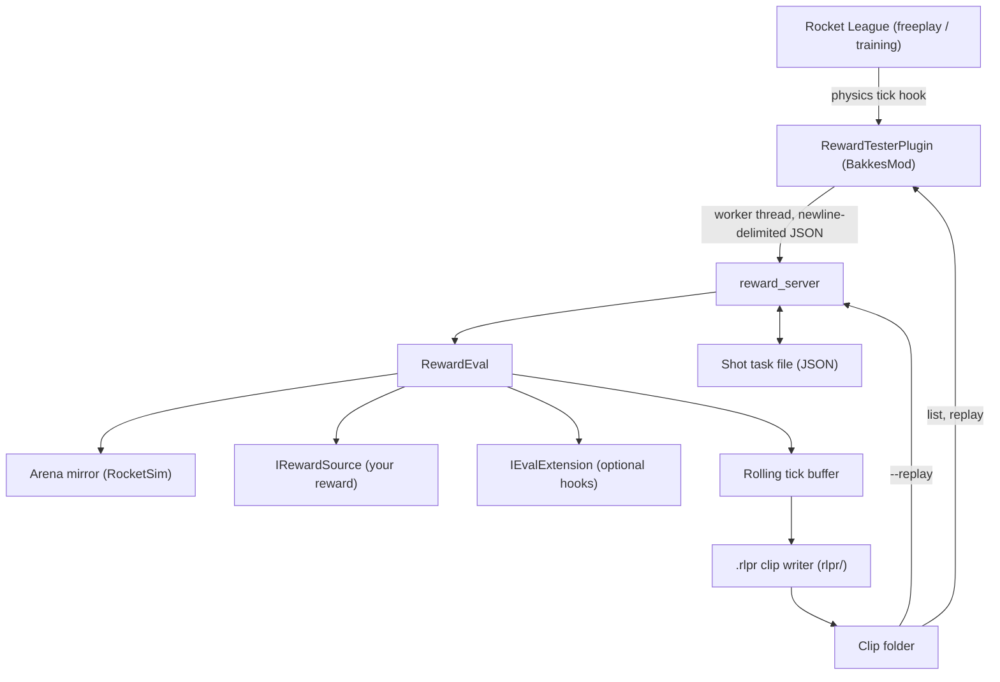

# Architecture

***

## Components

The **plugin** snapshots every car and the ball on each physics tick and hands the newest snapshot to a worker thread (`RewardClient`). The game thread reads the newest result for display and never waits. The same client sends clip, task and reset requests. Clips are replayed by loading `.rlpr` files and setting car and ball state tick by tick.

The **server** is a handful of files with one job each:

| File | What it does |
|---|---|
| `main.cpp` | Parses arguments, wires start-up, runs the listen loop |
| `session.cpp` | Holds the command table, one handler per protocol command |
| `line_socket.h` | Newline framing over one socket, with a size cap |
| `reward_eval.cpp` | Turns a request into a `GameState`, runs the arena mirror and the reward, keeps the clip buffer and the task list |
| `replay_cli.cpp` | Offline replay of `.rlpr` clips and the contact-timing self test |
| `reward_source.h` | `IRewardSource` and `IEvalExtension`, the two interfaces an integration implements |
| `user_reward.h` | The two functions an integration defines |

`rlpr/` is the clip codec. It reads and writes a fixed-layout binary recording of full-precision game states, for up to six cars. Readers accept the 28-byte and the 196-byte header dialects. Only the 196-byte one carries per-car team, so anything past 1v1 needs it.

***

## The Arena Mirror

BakkesMod can't tell you contacts, wheel state, flip and jump state, ball-hit info or game events. When collision meshes are available, the server mirrors the observed kinematics into a persistent RocketSim arena, steps it for the elapsed ticks with the observed controls, and copies the derived fields onto the `GameState` before your reward sees it. Without meshes the mirror is off.

Those fields are reconstruction evidence. A reward that depends on exact contact timing sees what the simulator says happened, which can differ from the game.

***

## One Tick

1.  Build a `GameState` from the request, or take it from a clip.
2.  Mirror the observed state and overlay the simulator-derived fields.
3.  `IEvalExtension::BeforeEvaluate`.
4.  `IRewardSource::PreStep`, then `Evaluate`.
5.  `IEvalExtension::AfterEvaluate`.
6.  Copy the tick into the rolling buffer and keep it as the next tick's previous state.

***

## Dependencies

| Dependency | Used by | Notes |
|---|---|---|
| GigaLearnCPP checkout | server, plugin | `RLGC::GameState`, RocketSim and nlohmann/json. Passed as `RS_FRAMEWORK_ROOT` |
| BakkesMod SDK | plugin | `%APPDATA%\bakkesmod\bakkesmod\bakkesmodsdk` |
| Dear ImGui | plugin | Vendored in `BakkesModPlugin/imgui` |

Nothing from a training project is referenced. A project's own glue, such as a reward loader or label detectors, lives in that project and comes in through `RS_INTEGRATION_SOURCES` and `RS_EXTRA_SOURCES`.
