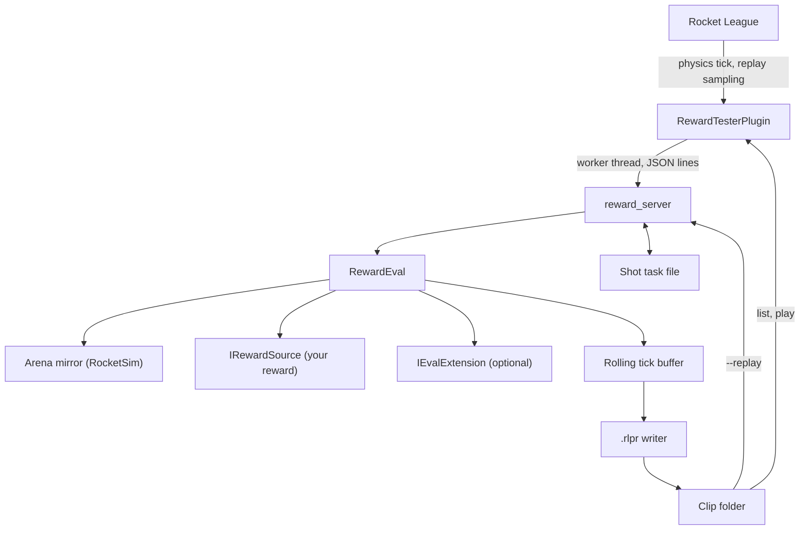

# Architecture

## Plugin

It snapshots the cars and the ball on each physics tick, or on each replay frame while you watch one, and hands the newest snapshot to a worker thread (`RewardClient`). The game thread reads the newest result and never waits. The same client sends clip, task and reset requests. Clips play by setting car and ball state tick by tick.

## Server

| File | What it does |
|---|---|
| `main.cpp` | arguments, start-up, listen loop |
| `session.cpp` | command table, one handler per command |
| `line_socket.h` | newline framing with a size cap |
| `reward_eval.cpp` | request to `GameState`, arena mirror, reward, clip buffer, task list |
| `replay_cli.cpp` | offline replay and the timing self test |
| `reward_source.h` | `IRewardSource` and `IEvalExtension` |
| `user_reward.h` | the two functions an integration defines |

`rlpr/` reads and writes the clip format: full-precision game states for up to six cars, in a 28-byte or a 196-byte header dialect. Only the 196-byte one carries per-car team.

## Arena mirror

BakkesMod doesn't give contacts, wheel state, flip and jump state, ball-hit info or game events. With collision meshes available, the server mirrors the observed kinematics into a RocketSim arena, steps it for the elapsed ticks with the observed controls, and copies the derived fields onto the `GameState` before your reward sees it. Without meshes the mirror is off.

These fields are reconstructed. A reward that depends on exact contact timing sees what the simulator says happened, which can differ from the game.

## One tick

1.  Build a `GameState` from the request or a clip.
2.  Mirror and overlay the simulator fields.
3.  `BeforeEvaluate`, `PreStep`, `Evaluate`, `AfterEvaluate`.
4.  Copy the tick into the rolling buffer and keep it as the next tick's previous state.

## Dependencies

| Dependency | Used by | Notes |
|---|---|---|
| GigaLearnCPP checkout | server, plugin | `RLGC::GameState`, RocketSim, nlohmann/json. `RS_FRAMEWORK_ROOT` |
| BakkesMod SDK | plugin | `%APPDATA%\bakkesmod\bakkesmod\bakkesmodsdk` |
| Dear ImGui 1.75 | plugin | vendored in `BakkesModPlugin/imgui` |

Project-specific glue, such as a reward loader or label detectors, lives in your project and comes in through `RS_INTEGRATION_SOURCES` and `RS_EXTRA_SOURCES`.
